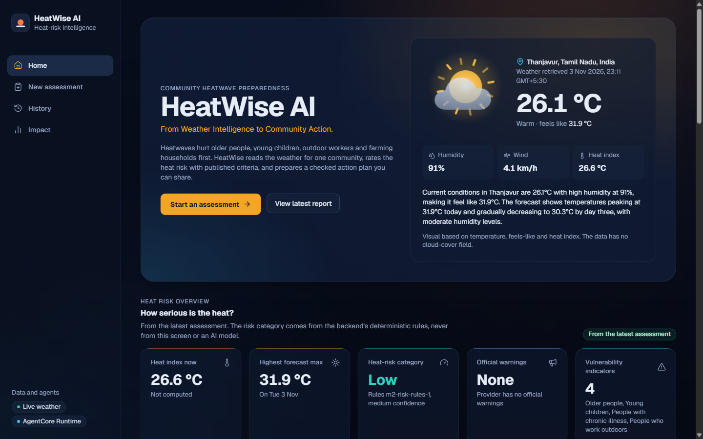
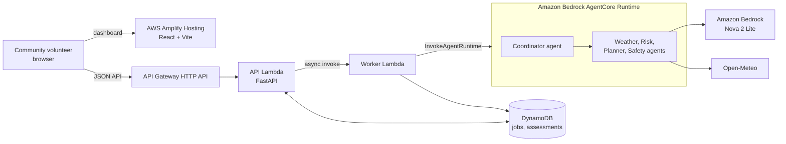

# HeatWise AI

From weather intelligence to community action.

HeatWise AI is a multi-agent heatwave preparedness assistant built with the [Strands Agents SDK](https://strandsagents.com/) and Amazon Bedrock. A community volunteer enters a place and a short, community-level profile (which groups live there, water, shade, terrain). A coordinator agent and four specialists turn live weather into a rules-based risk category and a verified before / during / after plan for households, outdoor workers and farmers, with a downloadable checklist.

It is an informational and preparedness tool. It is not a medical diagnosis tool, an emergency dispatch system, or a substitute for official warnings. It does not send alerts or contact anyone, and it makes no claim about real-world health outcomes.

Status: deployed in us-east-1 on 2026-11-03. The agents run on Amazon Bedrock AgentCore Runtime, the job API runs on AWS Lambda and API Gateway, and storage is in DynamoDB ([heatwise-ai/docs/deployment.md](heatwise-ai/docs/deployment.md), "Deployment log"). The dashboard is live on AWS Amplify Hosting at https://main.dmupjpltx9cou.amplifyapp.com, built from [`amplify.yml`](amplify.yml).



## Architecture


The diagram source is [`heatwise-ai/docs/architecture.drawio`](heatwise-ai/docs/architecture.drawio). Open it in [app.diagrams.net](https://app.diagrams.net) or with the Draw.io Integration extension in VS Code or Kiro.



The worker exists because an HTTP API request times out at 30 s and an agent run takes about 20-25 s. Details are in [heatwise-ai/docs/architecture.md](heatwise-ai/docs/architecture.md).

## Repository layout

- `heatwise-ai/`: the application. Backend, frontend, infrastructure, the AgentCore project, docs and the Kiro specs. The commands below run from this folder unless noted.
- `amplify.yml`: the AWS Amplify Hosting build spec (monorepo app root `heatwise-ai/frontend`).
- `README.md`, `LICENSE`: this file and the MIT license.

Screenshots: TODO (Home, Plan tab with checklist, Agent activity, Impact). Demo video: TODO (public link, under 3 minutes; script in [heatwise-ai/docs/demo-script.md](heatwise-ai/docs/demo-script.md)).

## Documentation

- [heatwise-ai/docs/agent-workflow.md](heatwise-ai/docs/agent-workflow.md): the five agents, hooks, steering, revision, fallback, sessions, and the evaluation loop.
- [heatwise-ai/docs/architecture.md](heatwise-ai/docs/architecture.md): local and AWS mode, data classification, DynamoDB keys, IAM, deployment status.
- [heatwise-ai/docs/evaluation.md](heatwise-ai/docs/evaluation.md): methodology and measured results on synthetic scenarios (generated).
- [heatwise-ai/docs/deployment.md](heatwise-ai/docs/deployment.md): build, deploy, smoke test, cost, destroy, deployment log.
- [heatwise-ai/docs/builder-center-article.md](heatwise-ai/docs/builder-center-article.md), [heatwise-ai/docs/demo-script.md](heatwise-ai/docs/demo-script.md), [heatwise-ai/docs/submission-checklist.md](heatwise-ai/docs/submission-checklist.md): hackathon submission material.

Development specs (requirements, design, task list), written with Kiro's spec-driven workflow, are in [`.kiro/specs/heatwise-ai/`](heatwise-ai/.kiro/specs/heatwise-ai/).

## How it works

- **Weather Intelligence Agent**: Open-Meteo current conditions and a 1-7 day forecast (no API key), each value tagged with provider, source URL, retrieval time, `live`/`demo` and staleness. Open-Meteo has no government warnings, so results say `alerts_supported: false` and point to IMD (https://mausam.imd.gov.in/) for Indian locations.
- **Community Risk Agent**: the category comes only from deterministic rules: NWS heat index bands (WPC algorithm), IMD actual-maximum criteria as an indication (never an official declaration), and a labelled, configurable vulnerability heuristic. The model writes only the explanation.
- **Action Planner Agent**: reads per-audience `SKILL.md` files (AgentSkills), selects items by id from a verified guidance catalog, and a deterministic fill guarantees hydration, rest, shade and escalation. Plans are English only; other languages get English plus a notice.
- **Safety and Verification Agent**: pass/fail comes only from deterministic checks (freshness, trusted sources, banned medical/diagnostic content and phone numbers, escalation, category consistency, unsupported claims).
- **Coordinator**: agents as tools, a steering handler for the order weather -> risk -> plan -> safety, one revision if safety fails (then `needs_human_review`, and only verified items are shown), and deterministic completion if the model stops early. Numbers come from a hook-captured evidence ledger, not from model text.
- **API and dashboard**: FastAPI (`backend/api/`) and React (`frontend/`): Home, New assessment, job progress, a report with Climate, Risk, Plan (checkboxes and "Download checklist") and Agent activity tabs, History, and Impact (stored-assessment counts plus a separate, labelled synthetic evaluation panel).

## Quickstart (offline, no AWS)

Requires Python 3.11+ (3.13 used), [uv](https://docs.astral.sh/uv/) and Node.js 22.

```powershell
cd heatwise-ai
uv venv .venv --python 3.13
uv pip install --python .venv\Scripts\python.exe -e ".[dev]"
cd frontend; npm install; npm run build; cd ..
```

Terminal 1 (API with scripted agents and labelled demo weather):

```powershell
$env:AGENT_MODE="offline"; $env:WEATHER_PROVIDER="demo"
.venv\Scripts\python.exe -m uvicorn backend.main:app --port 8000
```

Terminal 2 (dashboard on http://localhost:5173):

```powershell
cd frontend; npm run preview
```

Open http://localhost:5173/assess, pick `demo-hot-dry`, tick a few groups and run the assessment. API docs are at http://localhost:8000/docs. Stop both servers with Ctrl+C. The dashboard expects the API on `http://localhost:8000` (`VITE_API_BASE_URL`), and the API allows only the origin `http://localhost:5173` (or `127.0.0.1:5173`), so keep both ports.

## Live mode (Bedrock and Open-Meteo)

Uses your normal AWS credentials (profile, SSO or role) with `bedrock:InvokeModel` on `BEDROCK_MODEL_ID` (default `us.amazon.nova-2-lite-v1:0`) in `AWS_REGION` (default `us-east-1`). Open a fresh terminal (or `Remove-Item Env:AGENT_MODE, Env:WEATHER_PROVIDER`):

```powershell
.venv\Scripts\python.exe -m uvicorn backend.main:app --port 8000
```

From the command line instead of the dashboard:

```powershell
.venv\Scripts\python.exe -m backend.cli weather "Nagpur, Maharashtra" --tools-only
.venv\Scripts\python.exe -m backend.cli assess "Nagpur, Maharashtra" --elderly --outdoor-workers --farmers --checklist-out .\checklist.md
```

`assess` prints the report JSON to stdout and the agent trace to stderr; exit code 0 = `complete`, 2 = `needs_human_review`, 1 = `incomplete`. Other flags: `--days`, `--children`, `--pregnant`, `--chronic-illness`, `--limited-water`, `--limited-shade`, `--terrain plains|hilly|coastal`, `--language CODE`, `--session-id ID`.

## Evaluation

```powershell
.venv\Scripts\python.exe -m backend.evaluation run --mode offline
.venv\Scripts\python.exe -m backend.evaluation run --mode live --confirm-live --scenarios S01,S04,S08,S14 --knowledge S01,S04
.venv\Scripts\python.exe -m backend.evaluation report
```

Offline mode needs no network or AWS and also runs inside `pytest`. Live mode calls Amazon Bedrock, refuses to start without `--confirm-live` and is capped at 6 scenarios. Both write `backend/evaluation/results/evaluation-results.json` (one section per mode); `report` regenerates [heatwise-ai/docs/evaluation.md](heatwise-ai/docs/evaluation.md). Results are on synthetic test scenarios only. Install the judge dependency with the `dev` or `eval` extra (`strands-agents-evals==1.8.0`).

## Tests

Counts from the runs on 2026-11-03, after the AgentCore switch:

```powershell
cd heatwise-ai
.venv\Scripts\python.exe -m pytest                     # 338 passed, 4 deselected (live tests are opt-in: -m live)
cd frontend; npm run typecheck; npm run lint; npm test; npm run build; cd ..   # 10 test files, 73 tests
infrastructure\.venv\Scripts\python.exe -m pytest infrastructure\tests -q   # 16 passed (venv setup in heatwise-ai/docs/deployment.md)
```

No automated test calls Bedrock, AWS or the network (scripted models, fake and demo providers, moto).

## Configuration

Settings come from environment variables or `.env` (`backend/config.py`; every variable is listed, commented out, in `.env.example`). Local mode is the default: memory jobs on a thread pool, JSON files, file sessions. AWS mode is what the CDK stack sets on the Lambdas.

| Variable | Default | Meaning |
|---|---|---|
| `AGENT_MODE` | `bedrock` | `offline` runs the real agents with scripted models |
| `WEATHER_PROVIDER` | `open_meteo` | `demo` uses labelled fixtures |
| `AWS_REGION`, `BEDROCK_MODEL_ID` | `us-east-1`, `us.amazon.nova-2-lite-v1:0` | Bedrock target |
| `ASSESSMENT_STORE` | `json` | `json` (files in `ASSESSMENT_STORE_DIR`) or `dynamodb` (`ASSESSMENTS_TABLE_NAME`) |
| `JOB_STORE`, `JOB_DISPATCH` | `memory`, `thread` | `dynamodb` (`JOBS_TABLE_NAME`), `lambda` (`WORKER_FUNCTION_NAME`) |
| `JOB_TTL_DAYS`, `JOB_STALE_AFTER_SECONDS` | `7`, `420` | Job item TTL; a queued/running job older than this reads as `assessment_timed_out` |
| `SESSION_STORAGE` | `file` | `file` (`SESSION_DIR`, default `.data/sessions`), `s3` (`SESSION_BUCKET`, `SESSION_PREFIX`) or `none` |
| `EVALUATION_RESULTS_PATH` | packaged results file | File served by `GET /api/evaluation` |
| `HEATWISE_VERSION` | - | Version reported by `/api/health` when package metadata is missing |

## Deploying to AWS

The agents run on **Amazon Bedrock AgentCore Runtime**. The coordinator and four specialists are deployed as the runtime `HeatWiseAC_heatwise_agent` from `HeatWiseAC/`, with the `agentcore` CLI:

```powershell
.venv\Scripts\python.exe infrastructure\scripts\stage_agentcore_app.py   # copies backend/ into HeatWiseAC/app/HeatWise
cd HeatWiseAC; agentcore validate; agentcore deploy -y --json
```

Python CDK in `infrastructure/` adds the dashboard's job API:
- `HeatWiseData`: DynamoDB tables.
- `HeatWiseApi`: an API Lambda, an HTTP API, and a worker Lambda that calls `invoke_agent_runtime` and stores the report. Deploy it with `-c heatwise:agentcore_runtime_arn=<arn>`. Without that, the worker runs the agents itself.
- `HeatWiseFrontend` (optional): S3 + CloudFront.

Exact commands, cost notes and teardown order are in [heatwise-ai/docs/deployment.md](heatwise-ai/docs/deployment.md), "Deployment log".

## Sources

Risk thresholds and guidance cite only these pages, each fetched and read on 2026-11-02 (`backend/guidance/sources.py`):

| id | Publisher | URL | Used for |
|---|---|---|---|
| `nws_heat_index` | US National Weather Service | https://www.weather.gov/ama/heatindex | Heat index bands |
| `wpc_heat_index_equation` | NOAA Weather Prediction Center | https://www.wpc.ncep.noaa.gov/html/heatindex_equation.shtml | Heat index algorithm |
| `who_india_heat_waves` | WHO Country Office for India | https://www.who.int/india/heat-waves | IMD actual-maximum heat-wave criteria |
| `who_heat_health_factsheet` | World Health Organization | https://www.who.int/news-room/fact-sheets/detail/climate-change-heat-and-health | Vulnerability rationale, public actions |
| `ready_gov_extreme_heat` | Ready.gov (DHS/FEMA) | https://www.ready.gov/heat | Household actions, heat illness signs |
| `nws_heat_safety` | US National Weather Service | https://www.weather.gov/safety/heat | Vulnerable groups, never leave people/pets in cars |
| `who_workplace_heat_stress` | World Health Organization | https://www.who.int/news-room/questions-and-answers/item/workplace-heat-stress | Outdoor worker guidance |
| `fao_extreme_heat_agrifood` | FAO | https://www.fao.org/climate-change/news/news-detail/extreme-heat-in-an-el-ni%C3%B1o-year--how-agrifood-systems-can-prepare/en | Farmer, crop and livestock measures |
| `wsu_livestock_heat_wave` | Washington State University Extension | https://news.wsu.edu/news/2022/07/28/protect-livestock-pets-during-summer-heat-wave/ | Livestock water, handling, shade |

Not cited because they could not be read: osha.gov heat pages and cdc.gov/niosh (HTTP 403), 112.gov.in (timeout), ndma.gov.in heat-wave pages (404/PDF). No emergency number could be verified, so escalation text says to contact local emergency services or the nearest health facility.

## Layout (inside `heatwise-ai/`)

```
.kiro/specs/heatwise-ai/   requirements.md, design.md, tasks.md (Kiro spec-driven workflow)
backend/
  agents/      coordinator.py, weather_agent.py, risk_agent.py, planner_agent.py, safety_agent.py, hooks.py,
               model_factory.py, scripted.py (ScriptedModel), offline.py (AGENT_MODE=offline coordinator)
  api/         schemas.py, routes.py, app.py, jobs.py, dynamodb_jobs.py, summaries.py, checklist.py, errors.py
  evaluation/  datasets/, results/, dataset.py, provider.py, metrics.py, adversarial.py, runner.py, live.py,
               judge.py, results.py, report.py, __main__.py
  session/     store.py, dynamodb_store.py, dynamodb_schema.py, factory.py, sessions.py
  tools/       weather_tools.py, risk_tools.py, planning_tools.py, verification_tools.py
  services/    validation.py, claims.py, risk_rules.py, weather/{base, open_meteo, demo, factory}.py
  guidance/    sources.py (trusted sources), catalog.py (verified guidance items)
  skills/      household-heat-preparedness/, outdoor-worker-heat-safety/, farmer-heat-preparedness/ (SKILL.md)
  models/      weather.py, risk.py, plan.py, verification.py, report.py, trace.py
  tests/       offline unit, agent, API, AWS (moto) and evaluation tests; live tests (-m live); export_fixtures.py
  config.py, cli.py, main.py, lambda_api.py, lambda_worker.py, agentcore_handler.py, agentcore_entry.py
  agents/agentcore_client.py   worker -> AgentCore Runtime (AGENT_MODE=agentcore)
HeatWiseAC/    AgentCore CLI project (agentcore.json); app/ is staged by infrastructure/scripts/stage_agentcore_app.py
frontend/src/  api/, lib/, components/, routes/ (Landing, AssessForm, JobProgress, History, Impact, report/*), test/
infrastructure/ app.py, cdk.json, stacks/, scripts/build_lambda_asset.py, tests/, requirements*.txt, lambda-requirements.txt
docs/          architecture.drawio, agent-workflow.md, architecture.md, evaluation.md, deployment.md,
               builder-center-article.md, demo-script.md, submission-checklist.md
```

Runtime data (`.data/`), build output (`infrastructure/build/`, `cdk.out/`, `frontend/dist/`) and virtual environments are git-ignored.

## License

MIT. See [LICENSE](LICENSE).
