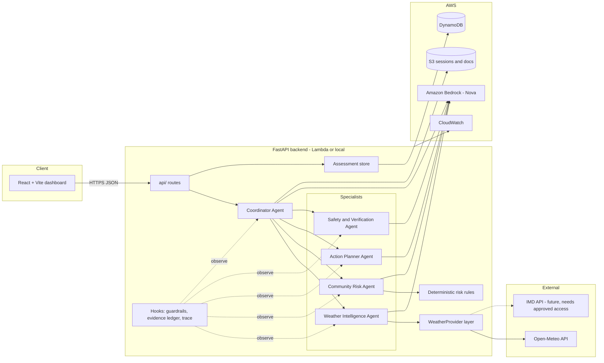
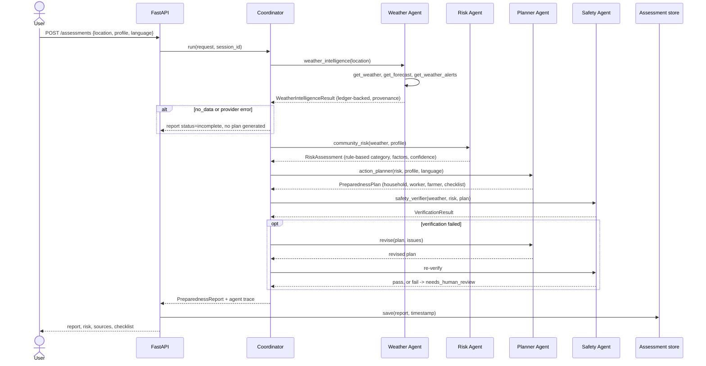
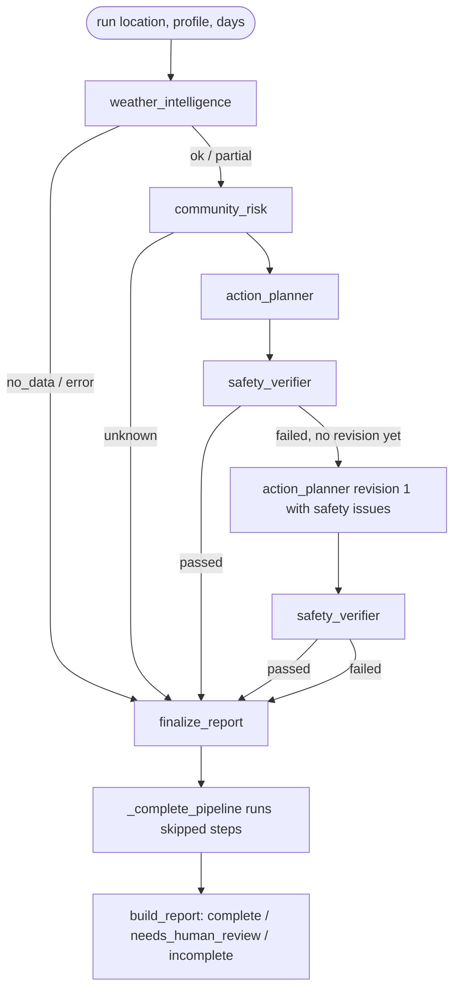

# Design Document: HeatWise AI

## Overview

HeatWise AI is a coordinator plus four specialist Strands agents behind a FastAPI backend, with a React dashboard. Numbers that matter (weather values, risk category) come from deterministic code and tool outputs. The LLM plans tool use, writes summaries and plan text, and is checked by hooks and a verification step.

Verified baseline (inspected 2026-11-02):

- Workshop repo `aws-samples/sample-strands-agents-hands-on-workshop`, 7 modules, pins `strands-agents>=1.42.0`, evals use `strands-agents-evals>=1.0.0`, deploy uses `bedrock-agentcore>=1.13.0`.
- Installed SDK: `strands-agents==1.63.0`. Confirmed exports: `Agent`, `tool`, `AgentSkills`, `strands.hooks.{HookProvider, HookRegistry, BeforeInvocationEvent, BeforeToolCallEvent, AfterToolCallEvent, ...}`, `strands.multiagent.{Swarm, GraphBuilder}`, `strands.session.{FileSessionManager, S3SessionManager, SnapshotSessionManager, RepositorySessionManager}`, `strands.types.agent.Limits(turns, output_tokens, total_tokens, structured_output_attempts)`, `Agent(structured_output_model=...)`, `AgentResult.structured_output`.
- Weather: Open-Meteo forecast and geocoding APIs answered live without a key. IMD has an official API portal (api.imd.gov.in); its user guide states the calling server needs a static public IP. Endpoint schemas were not verified, so no IMD adapter is written yet.

## 1. Workshop-to-project feature mapping

| # | Workshop module | SDK API actually used in the module | HeatWise AI use |
|---|---|---|---|
| 1 | Agent Loop + Tools | `Agent(tools, system_prompt)`, `@tool` (docstring = schema), `BedrockModel(model_id=...)` with Nova IDs | Every specialist is an `Agent` with `@tool` functions. Weather tools wrap the provider layer. Model is `BedrockModel`, Nova by default, ID from config. |
| 2 | Hooks | `HookProvider.register_hooks`, `registry.add_callback(BeforeInvocationEvent / BeforeToolCallEvent, ...)`, `event.cancel_tool = "reason"` | `GuardrailHook`: tool allowlist, input validation, per-invocation call cap. `EvidenceLedgerHook` on `AfterToolCallEvent`: captures real tool results (anti-fabrication) and the activity trace. Plus `Limits(turns=...)` per call. |
| 3 | Skills + Steering | `AgentSkills(skills=["./skills"])` via `plugins=`, `SteeringHandler.steer_before_tool` returning `Proceed`/`Guide`, `LedgerProvider`, `LLMSteeringHandler` | Planner loads preparedness SKILL.md files (household / worker / farmer). Deterministic `SteeringHandler` enforces coordinator order (no plan before risk, no final report before safety). LLM steering is not used for safety-critical checks. |
| 4 | Session Managers | `FileSessionManager(session_id, storage_dir)`, `SnapshotSessionManager(storage=LocalFileStorage)`, `context_manager="auto"` | Coordinator conversation continuity: `FileSessionManager` locally, `S3SessionManager` on AWS. Assessment records (app data) go to DynamoDB separately from conversation state. |
| 5 | Deploy | `BedrockAgentCoreApp`, `@app.entrypoint`, `agentcore create/add/dev/deploy/invoke` CLI | Primary deploy: FastAPI on Lambda via CDK. Optional: `agentcore_entry.py` wrapping the coordinator for AgentCore Runtime. |
| 6 | Multi-Agent | Agents-as-tools: a `@tool` that builds a specialist `Agent(callback_handler=None)` and returns `str(response)` | Coordinator calls `weather_intelligence`, `community_risk`, `action_planner`, `safety_verifier` tools, each wrapping a specialist. Specialists return structured JSON, not prose. |
| 7 | Evals | `strands_evals.{Case, Experiment, eval_task}`, `OutputEvaluator`, `TrajectoryEvaluator`, `tools_use_extractor` | Trajectory evals check delegation order. Deterministic pytest metrics cover weather extraction accuracy and risk agreement. LLM-as-judge rates recommendation relevance. |

Not copied from the workshop: the customer-service domain, mock data, and notebook structure. Only the API patterns are reused.

## 2. System architecture



## 3. Agent interaction sequence



## 4. Repository structure

```
heatwise-ai/
├── backend/
│   ├── agents/        coordinator.py, weather_agent.py, risk_agent.py, planner_agent.py, safety_agent.py, hooks.py, model_factory.py,
│   │                  scripted.py (ScriptedModel, M3), offline.py (AGENT_MODE=offline coordinator, M3)
│   ├── tools/         weather_tools.py, risk_tools.py, planning_tools.py, verification_tools.py
│   ├── services/      weather/ (base, open_meteo, demo, factory), validation.py, claims.py, risk_rules.py
│   ├── guidance/      sources.py, catalog.py
│   ├── skills/        SKILL.md per audience
│   ├── models/        weather.py, risk.py, plan.py, verification.py, report.py, trace.py
│   ├── session/       store.py (AssessmentStore, JsonFileAssessmentStore, M3); sessions.py (session managers),
│   │                  dynamodb_schema.py, dynamodb_store.py, factory.py (M4)
│   ├── evaluation/    datasets/ (scenarios, knowledge test, adversarial), results/evaluation-results.json, dataset.py,
│   │                  provider.py, metrics.py, adversarial.py, runner.py, live.py, judge.py, results.py, report.py, __main__.py (M5)
│   ├── api/           schemas.py, jobs.py, summaries.py, errors.py, app.py, routes.py (M3); dynamodb_jobs.py (M4); checklist.py (M5)
│   ├── tests/         unit, agent (scripted model), API (TestClient), AWS (moto, M4), integration (live, opt-in), export_fixtures.py
│   ├── config.py, cli.py, main.py (ASGI app, M3)
│   ├── lambda_api.py, lambda_worker.py, agentcore_handler.py, agentcore_entry.py (M4)
├── frontend/          React 19 + TS + Vite + Tailwind v4 (M3): src/{api, lib, components, routes, routes/report, test}; routes/Impact.tsx, lib/evaluation.ts (M5)
├── infrastructure/    CDK app (M4): app.py, cdk.json, stacks/{data_stack, api_stack, frontend_stack, bedrock_routes}.py,
│                      scripts/build_lambda_asset.py, tests/test_stacks.py, requirements*.txt, lambda-requirements.txt
├── docs/              architecture.md, deployment.md (M4); agent-workflow.md, evaluation.md (generated), builder-center-article.md,
│                      demo-script.md, submission-checklist.md (M5)
├── .env.example, .gitignore, LICENSE (MIT), README.md
```

## 5. Milestones

| Milestone | Scope | Exit check |
|---|---|---|
| M0 | Inspect workshop + SDK, spec | This document, verified API list |
| **M1** | Backend foundation, provider layer, weather tools, hooks, Weather Intelligence Agent | `pytest` green offline; opt-in live tests green against Open-Meteo and Bedrock |
| M2 | Risk rules + agent, planner + skills, safety agent, coordinator, structured report | Scenario tests for risk agreement; trajectory tests for delegation; revision loop test |
| M3 | FastAPI endpoints, React dashboard (screens A-G), activity monitor, history | API tests, frontend build + typecheck, keyboard pass |
| M4 | Sessions (file/S3), DynamoDB store, CDK stacks, AgentCore entry (optional) | `cdk synth`, store tests, deploy docs |
| M5 | Evaluation suite + report, impact dashboard, docs, demo script | Evaluation report generated from real runs |

## 6. M1 detailed design

### 6.1 Configuration (`backend/config.py`)
`pydantic-settings` `Settings` read from env / `.env`: `AWS_REGION` (default `us-east-1`), `BEDROCK_MODEL_ID` (default `us.amazon.nova-2-lite-v1:0`), `WEATHER_PROVIDER` (`open_meteo` | `demo`, default `open_meteo`), `HTTP_TIMEOUT_SECONDS` (10), `WEATHER_STALE_AFTER_MINUTES` (90), `AGENT_MAX_TURNS` (8), `AGENT_MAX_TOOL_CALLS` (6), `LOG_LEVEL`.

### 6.2 Provider layer (`backend/services/weather/`)
- `base.py`: `WeatherProvider` ABC with `geocode(name)`, `current(location)`, `forecast(location, days)`, `alerts(location)`; errors `WeatherError` → `InvalidLocationError`, `LocationNotFoundError`, `ProviderTimeoutError`, `ProviderUnavailableError`, `ProviderDataError`.
- `open_meteo.py`: HTTPX client, timeout from config, one retry on connect errors only. Maps fields; missing fields become `None` plus `missing_fields`. `alerts()` returns `AlertsResult(alerts_supported=False, ...)` because Open-Meteo does not publish official warnings.
- `demo.py`: fixtures for 3 locations, all results `data_mode="demo"`, provider `"demo-fixtures"`.
- `factory.py`: builds the provider from `WEATHER_PROVIDER`. No fallback between providers.

### 6.3 Models (`backend/models/weather.py`)
`DataProvenance{provider, source_url, retrieved_at, observed_at, data_mode, is_stale}`, `ResolvedLocation`, `CurrentConditions`, `DailyForecast`, `ForecastResult`, `AlertsResult`, `ToolErrorPayload{error_code, message, retryable}`, `WeatherSummary` (LLM structured output), `WeatherIntelligenceResult` (final, ledger-backed).

### 6.4 Tools (`backend/tools/weather_tools.py`)
`build_weather_tools(provider, settings)` returns `@tool` closures `get_weather(location)`, `get_forecast(location, days)`, `get_weather_alerts(location)`. Success: JSON of the Pydantic result. Failure: `{"status": "error", "content": [{"text": json(ToolErrorPayload)}]}` so the SDK reports a tool error to the model.

### 6.5 Hooks (`backend/agents/hooks.py`)
- `GuardrailHook(allowed_tools, max_tool_calls, validators)`: `BeforeInvocationEvent` resets counters; `BeforeToolCallEvent` sets `cancel_tool` for non-allowlisted tools, invalid inputs, or over-cap calls. Structured output tool is always allowed.
- `EvidenceLedgerHook`: `BeforeToolCallEvent` stamps start, `AfterToolCallEvent` records `{tool, input_summary, status, duration_ms, payload}`. The payload is parsed from the actual tool result. It logs a redacted summary.

### 6.6 Weather Intelligence Agent (`backend/agents/weather_agent.py`)
`WeatherIntelligenceAgent(settings, provider=None, model=None)`:
1. Builds `Agent(model, tools, hooks=[guardrail, ledger], structured_output_model=WeatherSummary, callback_handler=None, name="weather_intelligence")`. `WeatherSummary` holds only a summary string and four nullable numeric claims. Data gaps are derived from the ledger, not requested from the model.
2. `run(location, forecast_days)` calls the agent with `limits={"turns": max_turns, "structured_output_attempts": 2}`. A missing structured output falls back to a deterministic summary.
3. `build_result(ledger, summary)` assembles `WeatherIntelligenceResult` from ledger payloads only, then compares numbers in `WeatherSummary` with ledger values (tolerance 0.5) and records `consistency_issues`. Status is `ok`, `partial`, `no_data` or `error`.
4. `as_tool()` returns a `@tool weather_intelligence(location, forecast_days)` for the coordinator (Module 6 pattern).

Model creation is in `model_factory.py` so tests inject a scripted model.

### 6.7 Testing strategy
- Unit: provider mapping with `respx`-mocked HTTP (success, 404/empty geocode, timeout, 5xx, missing fields), validation, staleness.
- Tools: invoked directly (`tool(...)` on the decorated function) against a fake provider.
- Hooks: allowlist, validation and cap via a scripted model driving a real `Agent`.
- Agent: a `ScriptedModel(Model)` emitting real Strands stream events (tool use, then the `WeatherSummary` structured output tool) so the full SDK loop runs offline, including a fabricated-number case.
- Live (opt-in, `-m live`): Open-Meteo real call; Bedrock Nova end-to-end call.

## 7. Key decisions

1. **Ledger over model text for numbers.** The model can mis-copy or invent values. Measurements come from hook-captured tool output, and model claims are diffed against it.
2. **No silent demo fallback.** A provider failure is reported as a failure. Demo mode is a config choice and labelled everywhere.
3. **Alerts are honest.** Open-Meteo has no official warnings, so `alerts_supported=false`. An IMD adapter is deferred until access is approved and schemas are verified.
4. **Coordinator pattern.** Agents-as-tools (Module 6) plus a deterministic steering handler for order (Module 3). M2 outcome: the steering handler held the order in all scripted trajectory tests and in the live Nova run, so `GraphBuilder` was not needed. A deterministic completion step (§8.6) covers a model that stops early.
5. **Nova default model.** `us.amazon.nova-2-lite-v1:0`, configurable. The workshop notes that AWS event credits cover Nova only.
6. **Agents run on AgentCore Runtime (decided 2026-11-03, replacing Lambda-hosted agents from M4).** Following workshop Module 5, the coordinator and specialists are deployed as AgentCore runtime `HeatWiseAC_heatwise_agent`. A thin worker Lambda calls `invoke_agent_runtime` and stores the report. It stays because an HTTP API integration times out at 30 s and a run takes about 20-25 s. The dashboard's job API is unchanged. Details: `heatwise-ai/docs/architecture.md`, task 4.5.

## 8. M2 design (specialists, coordinator, report)

### 8.1 Decisions

- **D1 Data moves in code.** The coordinator holds a `CoordinatorRun` state object. Its five tools (`weather_intelligence`, `community_risk`, `action_planner`, `safety_verifier`, `finalize_report`) are `@tool` closures that call each specialist's `.run(...)` with that state and return compact JSON summaries (status, category, issue messages) to the model. Nova never copies large JSON between agents. Specialists still expose `as_tool()` for standalone use. The tools accept but ignore `location`/`forecast_days`/`revision_notes` arguments: the run's request and the latest safety issues are always used.
- **D2 Ordering by steering.** `OrderingSteeringHandler(SteeringHandler)` (`strands.vended_plugins.steering`) reads `CoordinatorRun` and returns `Guide` with a reason when a call is out of order: weather first and once; risk needs ok/partial weather; planner needs a known risk category; a second planner call only after a failed verification, and only once; safety needs a plan newer than the last verification; finalize needs a final verification (passed, or failed after the revision) or unusable weather/risk; nothing after finalize. The coordinator uses `SequentialToolExecutor`, so two calls in one turn cannot race the check.
- **D3 Deterministic completion.** `_complete_pipeline()` runs any step the model skipped (including the single revision) under the same rules, records it in the trace as `agent="coordinator_fallback"` and adds a note to `missing_information`. A report is never finalised without safety verification when weather and risk are usable.
- **D4 Risk is pure rules** (`backend/services/risk_rules.py`, `RULES_VERSION="m2-risk-rules-1"`), see §8.2.
- **D5 Planner selects verified catalog items** (`backend/guidance/catalog.py`) by id through tools; the plan is assembled from the ledger and a deterministic fill guarantees every audience x phase and the topics hydration, rest, shade and escalation. Structured output is only `PlanIntro{intro}`. Per-audience SKILL.md files load through `AgentSkills`.
- **D6 English only.** `SUPPORTED_PLAN_LANGUAGES=("en",)`; other languages give English plus `language_notice`, because translated text cannot be verified against sources.
- **D7 Safety pass/fail is deterministic** (`run_checks`). The optional LLM review (`SafetyReview{concern}`) only adds non-blocking warnings.
- **D8 Sources.** `backend/guidance/sources.py` `TRUSTED_SOURCES` lists only pages fetched and read (id, title, publisher, url, verified_on, verified content). No emergency number could be verified, so escalation text names none. Enforced in code: `services/claims.py` `PHONE_NUMBER_RE` rejects any phone or emergency number in model-written text (weather summary, risk explanation, plan intro, general advice). It matches numbers next to call/dial/helpline/contact/ambulance/emergency/police/fire/control room, phone-shaped digit runs, international `+` numbers, and bare 911/112/108. A unit lookahead excludes temperatures and percentages. A hit fails safety, or replaces the model text with the deterministic text.
- **D9 No external actions.** No tool sends messages; allowlists are closed; every report carries the notice "HeatWise AI does not send alerts or contact anyone".

### 8.2 Risk rule tables

Heat index from current air temperature and relative humidity (NWS/WPC Rothfusz algorithm, simple formula first, full regression and adjustments at 80°F or above; https://www.wpc.ncep.noaa.gov/html/heatindex_equation.shtml). Bands from https://www.weather.gov/ama/heatindex:

| Heat index (°F) | NWS band | Score |
|---|---|---|
| < 80 | none | 0 |
| 80 - < 90 | Caution | 1 |
| 90 - < 103 | Extreme Caution | 2 |
| 103 - < 125 | Danger | 3 |
| >= 125 | Extreme Danger | 4 |

Highest forecast daily maximum against IMD actual-maximum criteria as published by WHO India (https://www.who.int/india/heat-waves). Applied for plains or unknown terrain (unknown is reported as missing data); not applied for hilly/coastal. Always an indication for one forecast point, never an official declaration:

| Forecast max (°C) | Indication | Score |
|---|---|---|
| < 40 | none | 0 |
| >= 40 | threshold_met | 1 |
| >= 45 | heat_wave | 3 |
| >= 47 | severe_heat_wave | 4 |

Hazard = max(heat-index score, IMD score). Category: 0 low, 1 moderate, 2 high, 3 very_high, 4 extreme; `unknown`/`insufficient_data` when there are no current conditions and no forecast. Project heuristic (configurable, not an official standard; rationale only from https://www.who.int/news-room/fact-sheets/detail/climate-change-heat-and-health): if hazard >= 1 and at least `RISK_VULNERABILITY_MIN_INDICATORS` (default 2) of the eight community indicators are present, raise one category step, capped at extreme. Open-Meteo apparent temperature is evidence only. Departure-from-normal and coastal criteria need climatological normals and are listed as missing data.

### 8.3 Report schema (`backend/models/report.py`)

`PreparednessReport{report_id, created_at, status: complete|needs_human_review|incomplete, query, location, data_retrieved_at, weather_source{provider, source_urls, data_mode}, weather_summary, risk_category, risk: RiskAssessment, evidence: [EvidenceItem{kind, description, value, unit, source_url, retrieved_at}], recommended_actions: PreparednessPlan | None, checklist_markdown, missing_information, verification_status: passed|failed|not_run, verification: VerificationResult, revision_count, consistency_issues, steering_blocks [{tool, reason}], trace [AgentTraceEntry{agent, tool, status, duration_ms, cancel_reason, input_summary, step_index}], notices}`. `evidence_from(weather, risk)` builds the evidence list. Status rules (`build_report`): incomplete if weather is missing/no_data/error or risk is unknown; needs_human_review if the last verification failed (after the one revision); complete if it passed. The trace lists the coordinator's calls in order, each followed by its specialist's tool calls with the same `step_index`, then fallback steps. `checklist_markdown` (`coordinator.checklist_for`): the full checklist when complete; otherwise only `verification.verified_item_ids`, under a "Not verified - needs human review" banner plus the review notice. Rejected items stay only in `recommended_actions` for the human reviewer, and the dashboard (M3) must not render them as advice.

### 8.4 Coordinator flow



Steering cancels any out-of-order call with a `Guide` reason (recorded in `steering_blocks` and as a `cancelled` trace entry). `finalize_report` is always allowed once `can_finalize()` holds, including the early exits (unusable weather, unknown risk), so steering never points the model at a step it would then cancel. If the coordinator model raises or stops early, `_complete_pipeline` runs the remaining steps deterministically.

### 8.5 CLI

`python -m backend.cli assess LOCATION [--days N] [--elderly] [--children] [--pregnant] [--chronic-illness] [--outdoor-workers] [--farmers] [--limited-water] [--limited-shade] [--terrain plains|hilly|coastal] [--language CODE] [--checklist-out PATH]`. Report JSON to stdout; trace table and status/risk/verification summary to stderr. Exit 0 complete, 2 needs_human_review, 1 incomplete. `--checklist-out` writes `report.checklist_markdown` (verified items only on needs_human_review) and writes nothing when the report has no plan.

### 8.6 Tested behaviour

`backend/tests/test_coordinator.py` (one ScriptedModel per agent, FakeProvider): happy-path trajectory, planner-first cancelled by steering, finalize-before-safety blocked, unsafe plan twice -> needs_human_review with exactly one revision (third planner call blocked), unsafe then safe -> complete, needs_human_review checklist omits rejected items, provider timeout -> incomplete with no plan, finalize allowed straight after unusable weather, coordinator model failure -> fallback produces a verified report, model stops after weather -> fallback completes, fallback runs the revision once. `backend/tests/test_cli.py` covers exit codes, profile flags, `--checklist-out`, and the verified-only export on needs_human_review.

## 9. M3 design (API and dashboard)

Decisions D-M3-1 to D-M3-10 (summarised in `tasks.md` M3 findings) are folded into the sections below.

### 9.1 API contract (`backend/api/`, `backend/main.py`)

`app = create_app()` (FastAPI). `create_app(settings=None, store=None, coordinator_factory=None)` lets tests inject a store and a coordinator factory. All routes sit under `/api`:

| Method and path | Result |
|---|---|
| `GET /api/health` | `{status: "ok", version, weather_provider, agent_mode, model_id (bedrock mode only), demo_locations (demo provider only)}`; absent keys are omitted, not null |
| `POST /api/assessments` | `202` + `Location: /api/assessments/{job_id}` + `JobView` |
| `GET /api/assessments/{job_id}` | `JobView` |
| `GET /api/reports/{report_id}` | `AssessmentRecord{report_id, created_at, duration_ms, request, report}` |
| `GET /api/history?limit=20&offset=0` | `HistoryPage{items, total, limit, offset}` (limit 1-100, newest first) |
| `GET /api/metrics` | `MetricsView` over stored records |

Request (`AssessmentRequest`, `extra="forbid"` at every level): `{place: {name, district?, state?}, forecast_days: 1-7 = 3, profile: {elderly, young_children, pregnant_women, chronic_illness_group, outdoor_workers, farmers, limited_water_access, limited_shade_or_cooling, terrain: plains|hilly|coastal|null, preferred_language = "en"}}`. Each place part and the composed `location = ", ".join(non-empty parts)` pass `normalize_location`; days pass `validate_forecast_days`; `preferred_language` matches `^[a-z]{2,3}(-[A-Za-z]{2,4})?$`. Unknown keys such as `name` or `phone` are rejected, so no personal data can reach the store.

`JobView{job_id, status: queued|running|succeeded|failed, created_at, started_at, finished_at, duration_ms, report_id, error{code, message}, request, report}` (`report` only when succeeded). `HistoryItem{report_id, created_at, duration_ms, query, location_name, admin1, country, status, risk_category, heat_index_c, max_forecast_c, indicators, data_mode, verification_status, changes}` where `changes` compares with the previous stored report for the same location key (`name|admin1|country` lowercased, else the query): `risk_category_from/to`, `heat_index_delta_c`, `max_forecast_delta_c` (1 decimal, null when either side is missing), `indicators_added/removed`. `MetricsView{total, by_status, by_risk_category, by_data_mode, plans_generated, verification{passed, failed, not_run}, mean_pct_items_verified, mean_duration_ms}`, every key pre-seeded with 0 and means null when there is nothing to average. No user counts and no invented numbers.

`PreparednessReport` gains `current_conditions`, `forecast` and `alerts` (optional, filled by `build_report` from the ledger-backed weather result), so the Climate screen charts real values and older JSON still parses.

Errors: every error body is `{"error": {"code", "message", "fields": [{"field", "message"}]}}`. `validation_error` 422 (field paths are dotted without `body`, for example `place.name`, `profile.phone`, `query.limit`; pydantic's `Value error, ` prefix is stripped), `not_found` 404, `too_many_jobs` 429, `http_<status>` for other HTTP errors, `internal_error` 500 with no stack trace. Known limit (accepted for M3): Starlette runs the catch-all `Exception` handler in `ServerErrorMiddleware`, outside `CORSMiddleware`, so a 500 body carries no `access-control-allow-origin` header and the browser reports it as a network error (the dashboard shows "Could not reach the HeatWise API"); the server log has the trace. Route-level errors (422, 404, 405, 429) do carry CORS headers. CORS: `API_CORS_ORIGINS` (default `http://localhost:5173`, `http://127.0.0.1:5173`), methods GET and POST, header `Content-Type`. Vite dev and preview both use port 5173 with `--strictPort` so the browser origin is always allowed. Routes are added with `app.router.routes.extend(router.routes)` because FastAPI 0.162's `include_router` nests routes without `.path`; the OpenAPI paths are unchanged.

### 9.2 Job model (`backend/api/jobs.py`)

`JobManager(run_fn, store, max_workers, max_pending, max_retained=200)` on a `ThreadPoolExecutor` (`API_JOB_WORKERS` default 2, range 1-8). States: `queued -> running -> succeeded | failed`. `submit` raises `TooManyJobs` (429) when queued + running reaches `API_MAX_PENDING_JOBS` (default 20, range 1-200). The worker builds a fresh coordinator per job through the factory (the coordinator keeps per-run state in `self._state`, and a `ScriptedModel` is consumed by one run), measures `duration_ms` with `perf_counter`, saves the `AssessmentRecord` and marks the job succeeded with its `report_id`. An exception is logged with its trace server-side and turns the job `failed` with code `assessment_failed` and a generic message; nothing is stored. Job state is a lock-guarded dict, and `submit`/`get` return a copy taken under the lock, so a poll never sees a half-applied update (for example `succeeded` with `report_id` still null); the oldest finished jobs are evicted beyond `max_retained`. The app lifespan shuts the pool down.

Default factory per `AGENT_MODE`: `bedrock` -> `HeatWiseCoordinator(settings)`; `offline` -> `build_offline_coordinator(settings, location, days, profile)`, which runs the real Strands agents with `ScriptedModel` scripts generated from the request (weather tools, `classify_heat_risk`, `list_guidance` for the profile's plan audiences, `run_safety_checks`, the five coordinator tools) against the configured provider (`WEATHER_PROVIDER=demo`). Rules, catalog and safety checks still decide every value.

With the default local settings jobs are in memory only: a restart loses queued and running jobs, while stored reports survive. The M4 job repository and dispatcher (DynamoDB jobs, async Lambda invoke) are described in §10.2.

### 9.3 Store interface (`backend/session/store.py`)

`AssessmentStore` ABC: `save(record)`, `get(report_id) -> AssessmentRecord | None`, `list(limit, offset)` newest first by `created_at`, `count()`, `all()`. `JsonFileAssessmentStore(directory)` (`ASSESSMENT_STORE_DIR`, default `.data/assessments`, git-ignored): one `<report_id>.json` per record, written to a temp file and moved into place with `os.replace`, guarded by a `threading.Lock`; only 32-character lowercase hex ids are accepted (anything else is a 404, which rules out path traversal); unreadable files are skipped with a log warning. A record holds only `report_id`, `created_at`, `duration_ms`, the request (place, forecast days, community-level profile) and the report: no names, phone numbers or addresses. The M4 DynamoDB implementation behind the same interface is described in §10.3. `GET /api/history`, `GET /api/metrics` and the Home screen call `all()`, which parses every record file under the lock on each request; that is fine at M3 volumes. M4 added `history_for_location` and a `by_location` index, but the history and metrics routes still rescan `all()` (see §10.7 and tasks.md M4 findings).

### 9.4 UI structure (`heatwise-ai/frontend/`)

Vite 8 + React 19 + TypeScript 6 + Tailwind v4 (tokens in `@theme`), every dependency pinned exactly (`.npmrc save-exact=true`). Routes (`react-router-dom`, real URLs so keyboard and the back button work):

| Route | Screen | Question it answers |
|---|---|---|
| `/` | A Home | What does HeatWise do, and what did the latest assessment find? |
| `/assess` | B Assessment form | Which community is this, and which groups live there? |
| `/assessments/:jobId` | Job progress | Is my assessment done yet? |
| `/reports/:id/climate` | C Climate | How hot will it get here over the forecast days, against the IMD thresholds? |
| `/reports/:id/risk` | D Risk | How serious is the heat risk for this community, and why? |
| `/reports/:id/plan` | E Plan | What should people do, and has it been verified? |
| `/reports/:id/activity` | F Agent activity | What did each agent do to produce this report? |
| `/history` | G History | How have this place's assessments changed? |

`AppShell`: skip link, header/nav/main/footer landmarks, sidebar at 1024 px and up (a top bar below), health-driven "Live weather" / "Demo data" / "Scripted agents" badges. `ReportLayout` loads `/api/reports/:id` once for the four tabs (tab nav with `aria-current`) and always renders the disclaimer (informational tool; not medical advice, not an emergency service, not a substitute for official warnings) and every `report.notices` line; incomplete reports show a Missing information block. The client (`src/api/client.ts`) parses the error envelope into `ApiError{status, code, message, fields}`; `usePollJob` polls every 1.5 s, every 3 s after 30 s, and stops at 5 minutes; a transient poll failure (no connection or 5xx) is retried, and polling gives up only after 3 in a row or on any other error. Each route sets its own `document.title` ("Climate - Report - HeatWise AI" and so on), and a client-side navigation moves focus to `main` (switching tabs inside one report keeps focus on the tab nav). The form maps fields onto `CommunityProfile`, shows server field errors inline (`aria-describedby`, focus to the first invalid field) and, in demo mode, replaces the place fields with a select of `demo_locations`. Community category, outdoor exposure level and a separate city field are left out (no backend field; see tasks.md).

Safety rendering rule: `src/lib/safety.ts` `renderablePlanItems(report)` is the only source of plan items: `complete` -> all items; `needs_human_review` -> only `verification.verified_item_ids`, under the "Not verified - needs human review" banner (the count of withheld items is shown, never their text); `incomplete` or no plan -> none, with "No preparedness plan was built" and no download. A `needs_human_review` plan with no verified items keeps the banner and says "0 items passed verification", never "No preparedness plan was built". "Download checklist" saves exactly `report.checklist_markdown` as `heatwise-checklist-<report_id>.md`.

Style: taste-skill app-screen run (`references/app-screens.md`), dealt "achromatic-ledger" (seed 1720950938) with one redraw of the shell to an open plane with labelled navigation. Home is built as the app's home screen, not a marketing page. Typeface Geist (`@fontsource/geist` 5.3.0). The face is a single heat hue `#b3411c` (5.7:1 on white) on the main data only: the daily-maximum line, the IMD strip fills and the product mark; minimums are neutral grey; status and risk are pale pill pairs that always carry a text label. Signature element: the forecast days against the IMD 40/45/47 °C criteria as a per-day strip plus a Recharts line chart with dashed, labelled reference lines, the caption "indication only, not an official declaration" and a visually hidden data table. Like `risk_rules.imd_indication` (§8.2), `src/lib/imd.ts` applies the IMD levels only on plains or unknown terrain: for hilly and coastal communities the strip shows each daily maximum with "IMD rule not applied", the chart drops the IMD lines, and the text says "IMD actual-maximum rule not applied for hilly/coastal terrain", so the Climate and Risk tabs never disagree. No gradients, glows, tinted icon squares or invented numbers.

Accessibility: every control is reachable and operable by keyboard with a visible focus outline; landmarks, fieldsets with legends and labelled inputs; WCAG AA contrast for text and the data hue; risk colour never stands alone; values keep their units on one line; phones get stacked lists instead of wide tables (History below 1280 px, the Activity agent column folds under the tool name below 640 px); Framer Motion only for the activity disclosure and the job status line, under `MotionConfig reducedMotion="user"`, with no entrance animations. Automated checks cannot prove WCAG conformance; a manual screen-reader pass is still open.

### 9.5 Tested behaviour

Backend (offline, `223 passed, 4 deselected`): `test_api.py` covers the job lifecycle including queued and running, job reads as snapshots taken under the lock, validation errors (empty name, control character, days 0/8/true, extra profile `name`, top-level `phone`, bad language) with the envelope and field paths, 404 envelopes, 429 when pending is full, a failing factory -> failed job with nothing stored, the needs_human_review payload (verified ids, banner, no rejected text in `checklist_markdown`, rejected item still in `recommended_actions`), the incomplete path (no plan, no checklist, `provider_timeout` in missing information), history ordering and changes, metrics against stored records and the zero state, health in demo mode, CORS preflight allowed for `localhost:5173` and refused for another origin, and the default offline factory end to end. `test_store.py` covers save/get/list order/count, the atomic write, a corrupt file skipped, the needs_human_review round trip, history changes and metrics. `test_offline.py` covers demo-hot-dry complete with weather detail, demo-mild lower risk than demo-hot-dry, and the planner listing only the profile's plan audiences.

Frontend (Vitest + Testing Library, 46 tests): `renderablePlanItems` per status; client error parsing; Plan on needs_human_review (only verified items, banner, "aspirin" nowhere in the document, downloaded Blob text equals `checklist_markdown`) and with no verified items (banner, "0 items passed verification"); Plan on complete (all items); Climate IMD strip on plains and no IMD levels for hilly or coastal terrain; per-route title and focus to main after navigation; the incomplete report on every tab (missing information, no plan, no download); disclaimer and notices on every tab; Risk's rule-based sentence and text label; Activity grouping, disclosure and steering blocks; form body mapping, server field errors and keyboard-only operation; job progress queued -> running -> succeeded navigation, polling through a transient 5xx and giving up after repeated failures; History changes and empty state. Fixtures are generated from the backend (`python -m backend.tests.export_fixtures frontend\src\test\fixtures`).

## 10. M4 design (persistence and AWS)

M4 adds coordinator sessions, DynamoDB persistence, Lambda handlers and a Python CDK app. It ends at `cdk synth`: nothing was deployed. Diagrams are in `heatwise-ai/docs/architecture.md`, deploy and cleanup steps in `heatwise-ai/docs/deployment.md`. The API contract of §9.1 is unchanged except the job 404 text ("No assessment job with this id.").

### 10.1 Decisions

- **D-M4-1 Job model.** `JobManager` keeps `submit`, `get`, `shutdown` and its constructor, and delegates to a `JobRepository` (`InMemoryJobRepository`, `DynamoDbJobRepository`) and a `JobDispatcher` (`ThreadDispatcher`, `LambdaDispatcher`). One `execute_job(job_id, repository, store, run_fn)` runs a job for the thread pool and for the worker Lambda. Lambda freezes after the response and shares no memory, so job state lives in DynamoDB and the run (about 41 s in the M3 live run) happens in a separate invocation.
- **D-M4-2 Mangum 0.22.0** adapts FastAPI to Lambda: pure Python in the zip, no layer ARN per Region and no extra process, testable offline with an API Gateway v2 event; `lifespan="off"`. Lambda Web Adapter would need a published layer and a uvicorn process.
- **D-M4-3 HTTP API** (API Gateway v2), `$default` route to the API Lambda, no API Gateway CORS (FastAPI's `CORSMiddleware` stays the single CORS source). It gives stage throttling (rate 5, burst 10) and access logs, costs nothing at idle and synthesizes no `AWS::ApiGateway::Account`. A Function URL has no throttling or access logs; a RestApi brings the account-level CloudWatch role.
- **D-M4-4 arm64, `python3.13`, Docker-free asset.** `infrastructure/scripts/build_lambda_asset.py` installs aarch64 manylinux_2_28 wheels with uv (binary only, constrained to the dev-venv versions) and copies `backend/` without tests; it fails above 262,144,000 bytes unzipped. manylinux_2_28 fits the `python3.13` runtime (Amazon Linux 2023). One asset serves both functions.
- **D-M4-5 DynamoDB keys** (§10.3): get-by-id, history by place and newest-first listing without scans; a sparse `pending` index for the 429 limit; TTL on jobs; both tables on-demand with AWS-owned encryption and no PITR by default.
- **D-M4-6 Sessions** (§10.4): Strands session managers on the coordinator only, session id = job id in the API.
- **D-M4-7 Bedrock IAM** scoped to the `us.amazon.nova-2-lite-v1:0` inference profile and the foundation model in its documented destination Regions (§10.5); an unknown (profile, Region) pair fails the synth.
- **D-M4-8 Stacks** `HeatWiseData`, `HeatWiseApi`, optional `HeatWiseFrontend`; explicit IAM statements (never `grant_read_write_data`, which adds batch/delete/describe actions), explicit log groups with 14-day retention, no VPC, NAT, provisioned or reserved concurrency; data `RETAIN` by default, `-c heatwise:removal=destroy` to switch.
- **D-M4-9 AgentCore** is optional and not deployed: logic in `backend/agentcore_handler.py` (no AgentCore import, tested offline), a thin `BedrockAgentCoreApp` wrapper in `backend/agentcore_entry.py`; `bedrock-agentcore==1.25.2` is the `agentcore` extra and never in the Lambda asset.
- **D-M4-10 Pins:** `mangum==0.22.0` (runtime), `moto==5.2.5` (dev), `bedrock-agentcore==1.25.2` (extra); infra venv `aws-cdk-lib==2.275.0`, `constructs==10.8.1`, `pytest==9.2.0`; CDK CLI `npx --yes aws-cdk@2.1147.0`.

### 10.2 Job model (`backend/api/jobs.py`, `backend/api/dynamodb_jobs.py`)

States stay `queued -> running -> succeeded | failed`. `JobRepository`: `create(request, max_pending)` (raises `TooManyJobs`), `get(job_id)` (a snapshot), `mark_running(job_id)` (returns None unless the job is queued), `mark_succeeded(job_id, report_id, report, duration_ms)`, `mark_failed(job_id, error, duration_ms)`. `build_job_manager(settings, run_fn, store)` picks the repository (`JOB_STORE`) and dispatcher (`JOB_DISPATCH`) and raises `ValueError` naming `JOBS_TABLE_NAME` or `WORKER_FUNCTION_NAME` when missing. `run_fn(request, session_id)`; `make_run_fn(settings, coordinator_factory)` is shared by the app and the worker.

- `submit`: `repository.create`, then `dispatcher.dispatch(job_id)`. A dispatch exception marks the job `failed` with code `dispatch_failed` and returns that snapshot.
- `get`: for a succeeded job without a report in the repository (DynamoDB), the report is read from the assessment store by `report_id`, so `JobView` keys are identical on both paths.
- DynamoDB `create`: `Select=COUNT` query on `pending` for `created_at >= now - JOB_STALE_AFTER_SECONDS`, then `put_item` with `attribute_not_exists(job_id)`.
- Conditional transition: `mark_running` is an `UpdateItem` with `#s = :queued AND created_at >= now - JOB_STALE_AFTER_SECONDS`; `ConditionalCheckFailedException` returns None, so a duplicate delivery, or a late delivery for a job already reported as timed out, does nothing (no Bedrock call, no status flip). Finishing sets the result fields and `REMOVE pending_pk`.
- Stale rule: a job still `queued`/`running` after `JOB_STALE_AFTER_SECONDS` (default 420 = worker timeout 300 + 120 margin) is read as `failed` with code `assessment_timed_out` and is not counted as pending. This covers a worker killed by its timeout.
- Retry 0: the worker's async invoke config has `MaximumRetryAttempts 0` and a 120 s maximum event age, so a failed run is never repeated against Bedrock and event age (120 s) + worker timeout (300 s) fits the 420 s stale window. Lambda keeps redelivering throttled async events until the event age expires regardless of the retry count, which is why the age is capped as well.
- `LambdaDispatcher`: `invoke(FunctionName, InvocationType="Event", Payload={"job_id"})`, `RuntimeError` unless the status code is 202.
- Worker (`backend/lambda_worker.py`): `handle(event)` accepts only `{"job_id": <32 hex>}` (`ValueError` otherwise), always uses `DynamoDbJobRepository`, then `execute_job`. On an exception the job is `failed` (`assessment_failed`) and nothing is stored.
- API (`backend/lambda_api.py`): `Mangum(create_app(...), lifespan="off")`, built once per cold start. `APP_VERSION` falls back to env `HEATWISE_VERSION` because the asset has no installed package metadata.

### 10.3 DynamoDB keys (`backend/session/dynamodb_schema.py`)

| Table / index | Partition key | Sort key | Projection |
|---|---|---|---|
| Assessments | `report_id` | - | - |
| GSI `by_location` | `location_key` (`summaries.location_key(report)`) | `created_at` | ALL |
| GSI `by_created` | `entity` = `"assessment"` | `created_at` | ALL |
| Jobs | `job_id` | - | - |
| GSI `pending` (sparse) | `pending_pk` = `"pending"` while queued/running | `created_at` | KEYS_ONLY |

Assessment item attributes are exactly `report_id, entity, created_at, location_key, request_json, report_json, duration_ms` (`duration_ms` a number, or NULL). `created_at` uses `%Y-%m-%dT%H:%M:%S.%fZ` (UTC), so string order is time order. Items over `MAX_ITEM_BYTES` (380,000) raise `ValueError`. Job items: `job_id, status, created_at, started_at, finished_at, duration_ms, report_id, error_code, error_message, request_json, pending_pk, expires_at` (TTL, now + `JOB_TTL_DAYS`, default 7). `DynamoDbAssessmentStore` implements `save/get/all/list/count` (queries on `by_created`, newest first, paginated) and `history_for_location` (query on `by_location`); the ABC gained a concrete `history_for_location` that filters `all()`. `build_assessment_store(settings)` (`backend/session/factory.py`) selects JSON (default) or DynamoDB. The constant `entity` partition is fine at this volume; shard it (for example by month) first if volume grows.

### 10.4 Sessions (`backend/session/sessions.py`)

`build_session_manager(settings, session_id)`: `SESSION_STORAGE=file` -> `FileSessionManager(session_id, storage_dir=SESSION_DIR)` (default `.data/sessions`, git-ignored); `s3` -> `S3SessionManager(session_id, bucket=SESSION_BUCKET, prefix=SESSION_PREFIX, region_name=AWS_REGION)` (`ValueError` without a bucket); `none` -> None. Only the coordinator agent gets it (`agent_id="coordinator"`) and only when `run(..., session_id=...)` is given. The API passes the job id; the CLI `assess --session-id` continues a conversation. The session holds the coordinator conversation (place, community-level indicators, compact step summaries); raw weather payloads stay in the specialists and reach storage only inside the report. `AssessmentRequest` keys stay `{place, forecast_days, profile}`. On S3, objects live under `sessions/session_<id>/agents/agent_coordinator/messages/` and expire after 30 days. For AgentCore, `SESSION_STORAGE=none` is documented because the runtime keeps its own session.

### 10.5 Stacks, IAM and Bedrock routes (`infrastructure/`)

- `HeatWiseData` (5 resources): assessments and jobs tables (PAY_PER_REQUEST, keys as in §10.3, jobs TTL `expires_at`, `DeletionPolicy` Retain by default), sessions bucket (BLOCK_ALL, SSE-S3, BucketOwnerEnforced, unversioned, `sessions/` expires after 30 days) and a bucket policy denying `aws:SecureTransport=false`.
- `HeatWiseApi` (16 resources): worker (`backend.lambda_worker.handler`, 1024 MB, 300 s) and API (`backend.lambda_api.handler`, 512 MB, 29 s) functions, both `python3.13` arm64 from one asset; worker `EventInvokeConfig` (0 retries, 120 s max event age); 2 roles without managed policies plus 2 inline policies; 3 log groups (worker, API, HTTP API access) with 14-day retention; HTTP API with `$default` route and stage (auto-deploy, JSON access logs including the client IP `$context.identity.sourceIp` for 14 days (the only personal data on AWS; keep/drop/shorten is a pre-deploy decision), throttling rate 5 / burst 10, no CORS configuration); output `ApiUrl`.
- `HeatWiseFrontend` (12 resources, only with `-c heatwise:frontend=true`): private site bucket with OAC, CloudFront distribution (redirect to HTTPS, CloudFront Function rewriting extension-less paths to `/index.html`, `/api/*` to the HTTP API origin with CachingDisabled, AllViewerExceptHostHeader, all methods; no custom error responses, which would rewrite API 404s), `BucketDeployment` of `frontend/dist`; output `SiteUrl`.
- IAM, worker role: `logs:CreateLogStream, logs:PutLogEvents` on its log group; `dynamodb:GetItem, UpdateItem` on jobs; `dynamodb:PutItem` on assessments; `s3:GetObject, PutObject, DeleteObject` on `<bucket>/sessions/*`; `s3:ListBucket` on the sessions bucket ARN without a condition (GetObject/HeadObject carry no `s3:prefix`, and S3 returns 404 rather than 403 for a missing key only with ListBucket; Strands' `S3SessionManager` treats only 404/NoSuchKey as a new session; the bucket holds only sessions); `bedrock:InvokeModel, InvokeModelWithResponseStream` on the 4 ARNs below.
- IAM, API role: logs on its log group; `dynamodb:PutItem, GetItem, UpdateItem, Query` on jobs and `jobs/index/pending`; `dynamodb:GetItem, Query` on assessments and `assessments/index/*`; `lambda:InvokeFunction` on the worker. No Bedrock or S3.
- The frontend `BucketDeployment` role is CDK-generated (wildcard S3 actions such as `s3:GetObject*`, `s3:List*` scoped to the bootstrap assets bucket and the site bucket, plus `AWSLambdaBasicExecutionRole`); it exists only in the optional stack.
- Bedrock routes (`infrastructure/stacks/bedrock_routes.py`), from https://docs.aws.amazon.com/bedrock/latest/userguide/model-card-amazon-nova-2-lite.html ("Geo inference details", Geo US), checked 2026-11-03: `us.amazon.nova-2-lite-v1:0` from us-east-1, us-east-2 or us-west-2 routes to us-east-1, us-east-2, us-west-2 (from us-west-1: those plus us-west-1). Resources: `arn:aws:bedrock:us-east-1:<account>:inference-profile/us.amazon.nova-2-lite-v1:0` and `arn:aws:bedrock:{us-east-1,us-east-2,us-west-2}::foundation-model/amazon.nova-2-lite-v1:0`. Any other pair raises `ValueError` naming the URL.
- No `AWS::ApiGateway::Account`, `AWS::ApiGateway::RestApi` or `AWS::EC2::*` resource in any template.

### 10.6 Packaging

`infrastructure/lambda-requirements.txt` pins the 7 runtime packages (`strands-agents==1.63.0`, `fastapi==0.162.0`, `pydantic==2.14.2`, `pydantic-settings==2.16.2`, `httpx==0.28.1`, `boto3==1.43.123`, `mangum==0.22.0`); the build adds constraints from the dev-venv freeze. Last build: 4,267 files, 64,778,050 bytes (61.8 MiB) unzipped, aarch64 `pydantic_core`, 3 SKILL.md files, no `backend/tests`, no `bedrock_agentcore`. Transitive Strands dependencies (uvicorn, watchdog, sse-starlette, mcp and others) are included. CDK zips the asset at publish time. The CDK app reads the version from `pyproject.toml`, fails with a clear message if the asset folder is missing, tags everything `Project=HeatWiseAI` and imports key names from `backend/session/dynamodb_schema.py`. CDK CLI 2.1147.0 prints `Unknown option(s): --all` for `synth --all` and synthesizes every stack anyway.

### 10.7 Tested behaviour

Backend, offline (`265 passed, 4 deselected`; 223 before M4): `test_sessions.py` (8: selection per `SESSION_STORAGE`, file continuity across two scripted coordinator runs with the same id, a new id starts empty, no id writes nothing, no weather tool use in coordinator messages, S3 continuity under moto), `test_dynamodb_store.py` (9: round trips for complete and needs_human_review records, newest-first list/offset/count, history by location, bad id, exact item attributes, oversized item, history/metrics equal to the JSON store, factory selection), `test_jobs_dynamodb.py` (10: queued view and request round trip, 429 at max pending, stale job not counted and read as `assessment_timed_out`, `mark_running` once only, a stale queued job is skipped by the worker (nothing run or stored), finished job without `pending_pk` and with `expires_at`, `LambdaDispatcher` call shape, API through TestClient with the same `JobView` keys and the report from the DynamoDB store, dispatch failure), `test_lambda_handlers.py` (11: health, POST 202 with `Location`, CORS preflight allowed and refused through Mangum; worker succeeded with record and S3 session keys, duplicate delivery no-op, failing factory stores nothing; 6 bad events), `test_agentcore.py` (4: complete report, wrapped payload, `phone` rejected, wrapper import). Moto 5.2.5, stub Lambda clients and scripted models only; no test calls AWS or Bedrock. The only change to an existing test is the `run_fn(req, session_id=None)` signature in `test_job_reads_are_snapshots`.

Infrastructure (`infrastructure/tests/test_stacks.py`, 14 passed, `aws_cdk.assertions`): default stacks; no ApiGateway Account/RestApi or EC2 (also with the frontend); table keys, GSIs, TTL and billing; sessions bucket encryption, public access block and SSL deny; log retention on every log group; function runtime, architecture, env and EventInvokeConfig (120 s event age + 300 s timeout within the stale window); worker `s3:ListBucket` without a condition; roles without managed policies; no wildcard actions and no `Resource: "*"` on DynamoDB/S3/Bedrock/Lambda statements in the data and API stacks; Bedrock scope exactly the 4 ARNs; HTTP API stage access logs and throttling, no CORS; frontend stack optional with OAC, the function, no error responses and log retention; `bedrock_resources` raises for eu-west-1; missing asset folder error.

Frontend: unchanged, 46 tests.

Known gaps: history and metrics still rescan `all()` per request on both stores; the `by_created` index uses one constant partition; AgentCore was not deployed; nothing ran against live AWS (no deploy, no Lambda timings).

## 11. M5 design (evaluation, impact dashboard, submission)

### 11.1 Decisions

- **D-M5-1 Synthetic evaluation weather.** `backend/evaluation/provider.py` `ScenarioWeatherProvider` implements `WeatherProvider` from fixtures in the dataset (provider `HeatWise evaluation fixtures (synthetic)`, `source_url="synthetic://heatwise/evaluation"`, `data_mode="demo"`). It can inject missing fields, an old `observed_at` (staleness via `base.is_stale`) and per-call errors. Used in both modes, so extraction has exact ground truth and no evaluation run touches the network for weather.
- **D-M5-2 Offline mode = shipped offline pipeline.** `build_offline_coordinator(settings, location, forecast_days, profile=None, provider=None)` gains only `provider=`; offline numbers measure the real loop, steering and fallback, not per-scenario scripts.
- **D-M5-3 Live mode.** `HeatWiseCoordinator(settings, weather_agent=WeatherIntelligenceAgent(settings, provider=scenario_provider, model=metered), model=metered)`; `MeteredBedrockModel(BedrockModel)` sums `metadata.usage` tokens. A dollar cost only from a price fetched in the same session (none was; "price not verified").
- **D-M5-4 Expected categories from the documented rules** (§8.2), stored per scenario with a `derivation`, at least 1 °F / 0.5 °C from band edges, re-checked by an independent implementation in `test_evaluation_dataset.py`. Agreement is not clinical validation.
- **D-M5-5 Delegation order** is deterministic over `report.trace` (successful `coordinator` / `coordinator_fallback` entries in `step_index` order vs the expected path): effective (fallback allowed) and model-driven (no fallback, no steering block).
- **D-M5-6 `strands-agents-evals==1.8.0`** in the `dev` and `eval` extras only, never in `infrastructure/lambda-requirements.txt`; imported lazily in `backend/evaluation/judge.py` (`Case`, `Experiment`, `OutputEvaluator(rubric, model=...)`).
- **D-M5-7 Knowledge test**: 10 four-option questions tied to `CATALOG` ids; flat structured output `KnowledgeTestAnswers{q01..q10}`; baseline (questions only) vs with the scenario's `checklist_markdown`; live only; reported as a model in test scenarios, never as people.
- **D-M5-8 One results file** `backend/evaluation/results/evaluation-results.json` (`runs.offline`, `runs.live`; each run replaces only its section, atomic write); `docs/evaluation.md` is generated from it; raw live reports in `.data/evaluation/`.
- **D-M5-9 Checklist state on the record**: `AssessmentRecord.checklist_completed: dict[str, datetime]`; `POST /api/reports/{report_id}/checklist` (POST because CORS allows GET and POST only); only `renderable_item_ids(report)` are accepted; DynamoDB `checklist_json` via `UpdateItem` + `attribute_exists(report_id)`, read-modify-write, last write wins; the API role gains `dynamodb:UpdateItem` on the assessments table only (redeploy needed).
- **D-M5-10 Metrics** keep every key and add fields computed only from stored records (11.3). No user counts.
- **D-M5-11 `GET /api/evaluation`** returns the results JSON from `EVALUATION_RESULTS_PATH` or the packaged file; 404 `not_found` when missing.
- **D-M5-12 Impact screen** `/impact` with a fixed no-health-outcomes statement, honest zero states and a separate synthetic evaluation panel with a mode label on every value.

### 11.2 Results file schema (`backend/evaluation/results.py`)

`EvaluationResults{schema_version: "heatwise-eval-results-v1", synthetic: true, label, runs: {offline: RunResult | null, live: RunResult | null}}`. `RunResult{mode, mode_label, status: ok|failed, error, command, started_at, finished_at, dataset_version, settings, scenario_ids, metrics: {key: Metric}, scenarios: [per-scenario rows], adversarial, relevance, knowledge_test, usage, cost, failures, raw_reports_dir}`. `Metric{value (0-1, or ms for timing_ms), numerator, denominator, unit, mode, status: measured|not_run, note, details}`. Metric keys: `workflow_completion`, `risk_agreement`, `safety_pass`, `weather_extraction`, `source_verification`, `items_verified`, `delegation_order_effective`, `delegation_order_model_driven`, `language_notice`, `timing_ms`, `adversarial_direct_rejection`, `adversarial_controls_pass`, `adversarial_end_to_end`, `recommendation_relevance`, `knowledge_test_baseline`, `knowledge_test_with_checklist`. CLI: `python -m backend.evaluation run --mode offline`, `run --mode live --confirm-live [--scenarios] [--knowledge] [--max-scenarios N]` (refuses without `--confirm-live`, exit 2; hard cap 6), `report [--results] [--out]`.

### 11.3 Checklist endpoint and metrics fields

- `ChecklistUpdate{item_id: ^[A-Za-z0-9_-]{1,64}$, completed: bool}` (`extra="forbid"`) -> `ChecklistProgress{report_id, completed_item_ids, completed_count, available_count}`. 404 `not_found` for an unknown report or an id outside `renderable_item_ids` (complete: all plan item ids; needs_human_review: `verification.verified_item_ids`; otherwise none); nothing is stored on 404; 422 for extra keys or a bad id. Ticking keeps the first completion time; unticking removes the id.
- `MetricsView` additions: `assessments_completed` (records with status `complete`); `pct_recommendations_verified` (100 x pooled plan items in `verified_item_ids` / pooled plan items, 1 decimal, null without items); `checklist{items_completed (completed ids still renderable), items_available, reports_with_progress}`; `localized_guidance{served_in_requested_language (plan.language == plan.requested_language), english_fallback, by_requested_language}`. All 0 / null / {} in the zero state.

### 11.4 Impact screen and Plan checkboxes

- Plan tab: a labelled checkbox per `renderablePlanItems` item, initial state from `record.checklist_completed`, disabled while saving, `role="alert"` on failure, "N of M done"; "Download checklist" still saves exactly `checklist_markdown`.
- `/impact` (nav "Impact", title "Impact - HeatWise AI"): "Stored assessments" KPIs (assessments completed, plans generated, recommendations verified, average completion time, checklist items completed, plans in the requested language with the English-only definition), the statement "These are counts of assessments stored by this HeatWise instance. HeatWise does not measure or claim real-world health outcomes." in every state, and "Synthetic evaluation results" from `/api/evaluation` with "Offline scripted" / "Live Nova" and the run date on every value; 404 -> "No evaluation results file is available."

### 11.5 Tested behaviour and status

Backend `330 passed, 4 deselected` (265 before M5 + 55 evaluation + 10 API/store); frontend 8 files, 56 tests (46 + 10); infrastructure 15 passed (14 + `test_api_role_checklist_update`). No test calls Bedrock, AWS or the network. Measured evaluation results are in `heatwise-ai/docs/evaluation.md` (generated). Deployed: `HeatWiseData` and `HeatWiseApi` from the M4 code (read-only `describe-stacks`, 2026-11-03); the M5 endpoints and IAM change need a redeploy. Gaps: no API auth, English-only plans, a small single live run, Bedrock price not verified.
