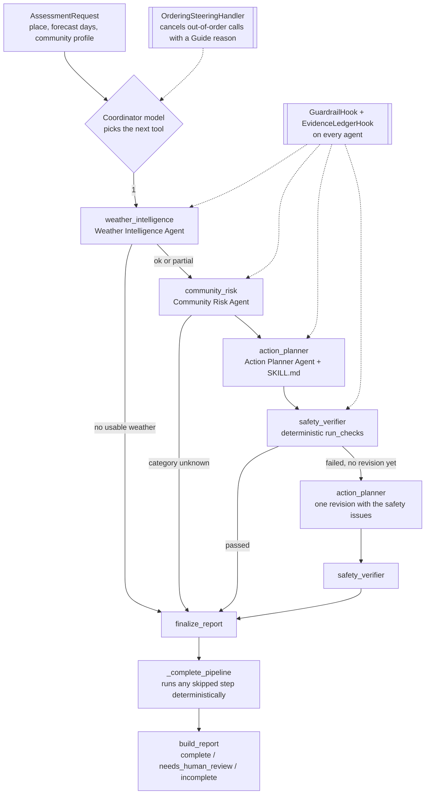
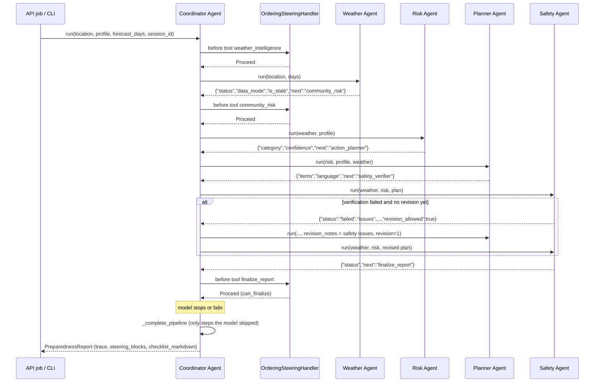

# HeatWise AI agent workflow

This page explains how one assessment moves through the agents, which Strands features hold the order and the safety rules in place, and how the evaluation suite exercises the same code. Every name below is a class or function in this repository; file paths are relative to `heatwise-ai/`.

## The five agents

| Agent (`name`) | File | Tools | Structured output | What the model decides | What code decides |
|---|---|---|---|---|---|
| Coordinator (`coordinator`) | `backend/agents/coordinator.py` | `weather_intelligence`, `community_risk`, `action_planner`, `safety_verifier`, `finalize_report` | - | Which specialist to call next | Order (steering), revision limit, report status, checklist |
| Weather Intelligence (`weather_intelligence`) | `backend/agents/weather_agent.py` | `get_weather`, `get_forecast`, `get_weather_alerts` (`backend/tools/weather_tools.py`) | `WeatherSummary` | Tool calls and a short summary | Every weather value (from the evidence ledger) |
| Community Risk (`community_risk`) | `backend/agents/risk_agent.py` | `classify_heat_risk`, `get_risk_rules` (`backend/tools/risk_tools.py`) | `RiskExplanation` | The explanation text | The risk category (`backend/services/risk_rules.py`) |
| Action Planner (`action_planner`) | `backend/agents/planner_agent.py` | `list_guidance`, `select_guidance`, `add_general_advice` (`backend/tools/planning_tools.py`) and the `skills` tool | `PlanIntro` | Which catalog items to select, a few general notes, the intro | Items come from the verified catalog (`backend/guidance/catalog.py`); a deterministic fill adds hydration, rest, shade and escalation |
| Safety and Verification (`safety_verifier`) | `backend/agents/safety_agent.py` | `run_safety_checks` (`backend/tools/verification_tools.py`) | `SafetyReview` | One optional, non-blocking concern | Pass or fail (`run_checks`: freshness, trusted sources, banned medical, diagnosis and phone-number patterns, escalation, category consistency, unsupported claims) |

The coordinator uses the agents-as-tools pattern. Its tools are `@tool` closures over a `CoordinatorRun` state object; each one calls a specialist's `.run(...)` with data held in code and returns a compact JSON summary, so the model never copies weather or plan JSON between agents.

## Where the agents run

The same workflow runs in three places, chosen by `AGENT_MODE`:

| Mode | Where the five agents run | Used for |
|---|---|---|
| `agentcore` (deployed) | Amazon Bedrock AgentCore Runtime `HeatWiseAC_heatwise_agent`. `backend/agentcore_entry.py` wraps the coordinator in `BedrockAgentCoreApp` / `@app.entrypoint`. The worker Lambda calls `invoke_agent_runtime` with the `AssessmentRequest` JSON (`backend/agents/agentcore_client.py`) and gets the `PreparednessReport` back. | The public API and the dashboard on AWS |
| `bedrock` | In-process: the local API server, the CLI, or the worker Lambda without the runtime ARN | Local development and live tests |
| `offline` | In-process with scripted models | Tests and offline demos |

Hooks, steering, the revision loop and the safety checks are identical in all three, because the runtime runs the same `backend/` package (staged by `infrastructure/scripts/stage_agentcore_app.py`). On AgentCore, the conversation is keyed by `runtimeSessionId` (`heatwise-job-<job id>`), and `SESSION_STORAGE=none` keeps session files off the runtime's disk.

## Flow

Status rules (`preview_status` and `build_report` in `backend/agents/coordinator.py`):

- `incomplete`: no usable weather, or the risk category is `unknown`. No plan is built.
- `complete`: the last safety verification passed.
- `needs_human_review`: verification still failed after the one revision (`MAX_REVISIONS = 1`). The exported checklist (`checklist_for`) then lists only `verification.verified_item_ids` under a "Not verified - needs human review" banner. Rejected items stay in the report JSON for a human reviewer, and the dashboard renders only the verified items (`frontend/src/lib/safety.ts` `renderablePlanItems`, twin in `backend/api/checklist.py`).

## Sequence

## Strands features and where they are used

- `Agent` with `name`, `system_prompt`, `tools`, `hooks`, `plugins`, `structured_output_model`, `callback_handler=None`: all five agents (files in the table above).
- `@tool` from `strands`: the weather, risk, planning and verification tools (`backend/tools/`), and the coordinator's five delegation tools (`HeatWiseCoordinator._build_tools`).
- `BedrockModel` from `strands.models`: `backend/agents/model_factory.py` `build_bedrock_model` (model `us.amazon.nova-2-lite-v1:0` by default, temperature 0.1). Specialists share the coordinator's model unless given their own.
- Hooks (`strands.hooks`: `HookProvider`, `BeforeInvocationEvent`, `BeforeToolCallEvent`, `AfterToolCallEvent`) in `backend/agents/hooks.py`:
  - `GuardrailHook` cancels a tool call (`event.cancel_tool`) when the tool is not on the agent's allowlist, its input fails validation, or the per-request call cap is reached. The structured-output and `skills` tools are allowed but not counted.
  - `EvidenceLedgerHook` records every tool call with its parsed result, status, duration and a redacted input summary. Weather values, plan items and the activity trace are built from this ledger, not from model text.
- Per-invocation limits: `agent(prompt, limits={"turns": ..., "structured_output_attempts": 2})` in every agent. Structured output is capped at two attempts (an M1 finding: Nova repeated the same invalid value on every retry).
- `AgentSkills` plugin (`from strands import AgentSkills`) in `backend/agents/planner_agent.py`, loading `backend/skills/household-heat-preparedness/SKILL.md`, `outdoor-worker-heat-safety/SKILL.md` and `farmer-heat-preparedness/SKILL.md`.
- Steering plugin (`strands.vended_plugins.steering`: `SteeringHandler`, `Proceed`, `Guide`): `OrderingSteeringHandler` in `backend/agents/coordinator.py`. `decide(tool_name)` returns a reason for any out-of-order call (weather first, risk before plan, a plan must be verified before another plan, one revision only, finalize only when `can_finalize()` holds). The reason is returned to the model as guidance and kept in `report.steering_blocks`.
- `SequentialToolExecutor` (`strands.tools.executors`) on the coordinator, so delegations never run in parallel and the trace is in call order.
- Session managers (`strands.session`): `backend/session/sessions.py` `build_session_manager` returns `FileSessionManager` (local, `.data/sessions`), `S3SessionManager` (AWS, `sessions/` prefix) or nothing. Only the coordinator has a session; the API uses the job id as the session id. Raw weather payloads stay in the specialists, which have no session.
- `strands_evals` (`Case`, `Experiment`, `OutputEvaluator`): the live recommendation-relevance judge in `backend/evaluation/judge.py`, imported lazily inside its functions so the API never loads it.

## Deterministic fallback

If the coordinator model raises, runs out of turns or stops early, `HeatWiseCoordinator._complete_pipeline` runs the remaining steps under the same rules the steering handler enforces: weather, then risk, then plan, then safety, then the one revision if the last verification failed. Each fallback step is recorded with `agent="coordinator_fallback"` in the trace and named in `missing_information` ("The coordinator model skipped step(s) ...; they were run deterministically."). A report is never finalized without a safety verification when a plan exists.

## Offline mode

`AGENT_MODE=offline` builds the same coordinator and specialists with `ScriptedModel` (`backend/agents/scripted.py`), a Strands `Model` that replays fixed tool-call and text turns. `backend/agents/offline.py` `build_offline_coordinator` holds the scripts. The real agent loop, hooks, steering, fallback and report code run unchanged, so the dashboard and the tests work with no AWS access.

## Evaluation loop

`backend/evaluation/` drives the coordinator over synthetic scenarios (method and results in [evaluation.md](evaluation.md)):

1. `dataset.py` loads `datasets/scenarios-v1.json`, `knowledge-test-v1.json` and `adversarial-v1.json`.
2. `provider.py` `ScenarioWeatherProvider` serves each scenario's synthetic weather (including missing fields, stale observations and provider errors) through the normal `WeatherProvider` interface.
3. `runner.py` `run_offline` builds a fresh `build_offline_coordinator(..., provider=ScenarioWeatherProvider(...))` per scenario; `live.py` `run_live` builds a `HeatWiseCoordinator` with a `MeteredBedrockModel` that counts tokens.
4. `metrics.py` scores each report against the scenario: weather fields, risk category, verification status, sources, workflow status and delegation order (over `report.trace`), plus timing. `adversarial.py` injects unsafe items into a real plan and also runs a coordinator whose scripted planner adds unsafe text on both attempts.
5. `judge.py` (live only) runs the `strands_evals` relevance judge and the model knowledge test.
6. `results.py` writes `results/evaluation-results.json` (one section per mode) and `report.py` renders `docs/evaluation.md`. The API serves the results file at `GET /api/evaluation` for the Impact screen.

Commands: `python -m backend.evaluation run --mode offline`, `python -m backend.evaluation run --mode live --confirm-live [--scenarios ...] [--knowledge ...]`, `python -m backend.evaluation report` (from `heatwise-ai`, with the venv python).
