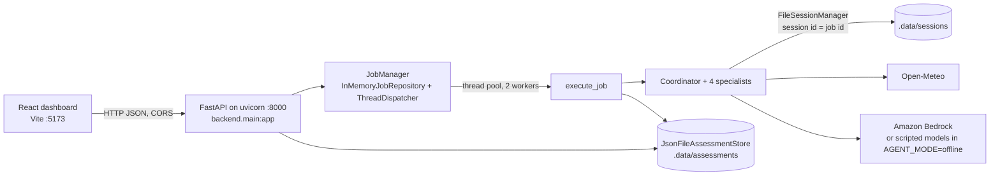
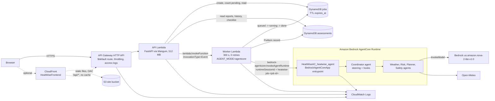
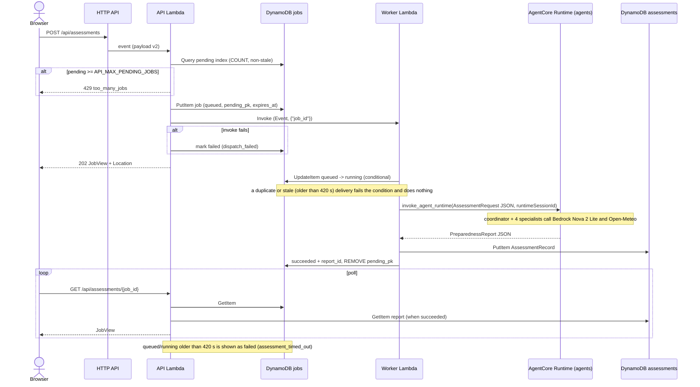

# HeatWise AI architecture (Milestone 5)

HeatWise AI runs the same backend code in two modes. Local mode is the M3 setup with file storage. AWS mode is defined in `infrastructure/` (Python CDK). Configuration (`backend/config.py`) picks the storage and job back ends; the API contract the dashboard uses is the same in both modes. The agent workflow itself is described in [agent-workflow.md](agent-workflow.md), and the evaluation suite in [evaluation.md](evaluation.md).

Diagram: [architecture.drawio](architecture.drawio). Open it in app.diagrams.net or a Draw.io editor extension.

**The agents run on Amazon Bedrock AgentCore Runtime.** The coordinator and its four specialists are deployed as the AgentCore runtime `HeatWiseAC_heatwise_agent` (`HeatWiseAC/`, `backend/agentcore_entry.py`). The HTTP API and a thin worker Lambda handle jobs, storage and the dashboard contract. The worker calls `invoke_agent_runtime` and runs no agents itself (`AGENT_MODE=agentcore`, `backend/agents/agentcore_client.py`).

Deployment status, us-east-1, 2026-11-03 (from the deploy outputs and the live checks in [deployment.md](deployment.md), "Deployment log"):

| Stack | Created by | Contents | Output |
|---|---|---|---|
| `AgentCore-HeatWiseAC-default` | `agentcore deploy` (CLI 0.31.1, CDK) | AgentCore Runtime `HeatWiseAC_heatwise_agent` (CodeZip, Python 3.13, HTTP, AWS_IAM inbound auth), its execution role and 2 policies | Runtime ARN, role ARN |
| `HeatWiseData` | `cdk deploy` (`infrastructure/`) | 2 DynamoDB tables, 1 S3 bucket and its bucket policy | Table and bucket exports |
| `HeatWiseApi` | `cdk deploy` with `-c heatwise:agentcore_runtime_arn=<arn>` | API Lambda, worker Lambda, 2 IAM roles, 3 log groups, HTTP API (1 route, 1 stage) | `ApiUrl` = `https://pwnenvmo71.execute-api.us-east-1.amazonaws.com` |

`HeatWiseFrontend` is not deployed; the dashboard runs locally against the API. The Milestone 5 additions below are deployed (the AgentCore switch redeployed `HeatWiseApi`). The sessions bucket in `HeatWiseData` is unused in AgentCore mode, because AgentCore keeps the session per `runtimeSessionId`. It stays because the stack still exports it.

## Components added in Milestone 5

- Checklist progress: `POST /api/reports/{report_id}/checklist` with `{"item_id", "completed"}` (`ChecklistUpdate`, `extra="forbid"`, id pattern `^[A-Za-z0-9_-]{1,64}$`) returns `ChecklistProgress{report_id, completed_item_ids, completed_count, available_count}`. Only items the dashboard shows are accepted (`backend/api/checklist.py` `renderable_item_ids`, the twin of `frontend/src/lib/safety.ts` `renderablePlanItems`: every plan item on `complete`, only verified items on `needs_human_review`, none otherwise); any other id or an unknown report gets 404 `not_found` and nothing is stored. Progress is community-level (which item ids are done and when), not per person.
- Storage: `AssessmentRecord.checklist_completed` (item id -> completed at). The JSON store rewrites the record under its lock; the DynamoDB store keeps it in an optional `checklist_json` attribute, written only when non-empty and updated with `UpdateItem` and `attribute_exists(report_id)` (read-modify-write, last write wins).
- Metrics: `GET /api/metrics` keeps every earlier key and adds `assessments_completed`, `pct_recommendations_verified`, `checklist{items_completed, items_available, reports_with_progress}` and `localized_guidance{served_in_requested_language, english_fallback, by_requested_language}`, all computed only from stored records (`backend/api/summaries.py` `compute_metrics`). There are no user counts.
- Evaluation: `backend/evaluation/` (datasets, scenario weather provider, metrics, offline and live runners, `strands_evals` judge, report generator, CLI). `GET /api/evaluation` serves `backend/evaluation/results/evaluation-results.json` (or `EVALUATION_RESULTS_PATH`), 404 `not_found` when the file is missing. `strands_evals` is never imported by the API and is not in the Lambda requirements.
- Dashboard: checkboxes on the Plan tab (only rendered items, "N of M done"), and a new Impact screen at `/impact` with the stored-assessment counts, the statement "These are counts of assessments stored by this HeatWise instance. HeatWise does not measure or claim real-world health outcomes.", and a separate "Synthetic evaluation results" panel with the mode and run date on every value.

## Local mode

Defaults: `JOB_STORE=memory`, `JOB_DISPATCH=thread`, `ASSESSMENT_STORE=json`, `SESSION_STORAGE=file`. Jobs still live in process memory and are lost on restart; stored reports and sessions survive.

## AWS mode

The API Lambda answers within its 29 s limit and never runs an assessment. An HTTP API integration times out at 30 s and an AgentCore run takes about 20-25 s, so the API can't wait for the runtime in the request. The worker makes one call per job to the runtime, with no retries, since a retry would start a second billable run. It then stores the report. The worker has no Bedrock model or S3 permissions in this mode, only `InvokeAgentRuntime` on that runtime and its endpoints. Without the `heatwise:agentcore_runtime_arn` context, the same stack runs the agents inside the worker instead (the Milestone 4 layout, used by the offline tests).

## Job sequence (AWS mode)

On an exception the worker logs the trace, marks the job `failed` (`assessment_failed`) and stores nothing.

## Data classification

| Data | Where | Content |
|---|---|---|
| Public weather data | Inside the report (`report_json`) | Open-Meteo values with provider, source URL and retrieval time. Raw tool payloads stay inside the specialist agents and are not written to the session. |
| Community profile | `request_json`, a separate attribute from `report_json` (Req 8.3) | Place name parts, forecast days, eight yes/no community indicators, terrain, preferred language. Community-level only. |
| Coordinator conversation | Session store (`.data/sessions` or `s3://<sessions bucket>/sessions/`, expires after 30 days on S3) | The coordinator's messages: place, community-level indicators, compact step summaries. |
| Jobs | Jobs table (TTL 7 days) or memory | Status, timings, error code, the request, the report id. |
| Checklist progress (M5) | `checklist_json` on the assessment item, or `checklist_completed` in the JSON record | Plan item ids marked done and the time they were first marked. Not linked to any person. |
| Evaluation results (M5) | `backend/evaluation/results/evaluation-results.json` (in the repo and the Lambda asset); raw live reports in `.data/evaluation/` (git-ignored) | Synthetic scenarios and their scores only. |
| HTTP API access log (AWS only) | CloudWatch Logs, 14 days | One JSON line per request, including the client IP (`$context.identity.sourceIp`). IP addresses are commonly treated as personal data; keeping, dropping or shortening this is a pre-deploy decision (docs/deployment.md, "Before you deploy"). |

No personal data is accepted in requests: `AssessmentRequest` uses `extra="forbid"` at every level, so a `name` or `phone` field is rejected with 422 before anything is stored. The application stores no personal data; the only personal data on AWS is the client IP in the API Gateway access log described above. Both data stores are encrypted at rest (DynamoDB AWS-owned keys, S3 SSE-S3) and the buckets deny non-TLS requests and block public access.

## DynamoDB key design

Key and attribute names live in `backend/session/dynamodb_schema.py` and are imported by the store, the tests and the CDK stack.

| Table / index | Partition key | Sort key | Projection | Used for |
|---|---|---|---|---|
| Assessments | `report_id` (32 hex) | - | - | `GET /api/reports/{id}` |
| GSI `by_location` | `location_key` (`name\|admin1\|country` lowercased) | `created_at` | ALL | History for one place, newest first |
| GSI `by_created` | `entity` = `"assessment"` | `created_at` | ALL | Newest-first list, paging, count, `all()` |
| Jobs | `job_id` | - | - | Job reads and transitions |
| GSI `pending` (sparse) | `pending_pk` = `"pending"` while queued/running | `created_at` | KEYS_ONLY | One `Select=COUNT` query for the pending limit |

`created_at` is always `%Y-%m-%dT%H:%M:%S.%fZ` in UTC, so string order is time order. Items larger than 380,000 bytes are refused (`ValueError`; the DynamoDB limit is 400 KB). The constant `entity` partition is fine at this volume and is the first thing to shard (for example by month) if volume grows. Both tables are on-demand.

## IAM summary

Every role is written out statement by statement, with no managed policies on the two function roles:

| Role | Allowed |
|---|---|
| Worker | `logs:CreateLogStream`, `logs:PutLogEvents` on its log group; `dynamodb:GetItem`, `dynamodb:UpdateItem` on the jobs table; `dynamodb:PutItem` on the assessments table; `s3:GetObject`, `s3:PutObject`, `s3:DeleteObject` on `<sessions bucket>/sessions/*`; `s3:ListBucket` on the sessions bucket ARN, without a condition (S3 answers 404 instead of 403 for a missing `session.json` only when the caller may list the bucket, and Strands treats only 404 as a new session; the bucket holds nothing but sessions); `bedrock:InvokeModel`, `bedrock:InvokeModelWithResponseStream` on the `us.amazon.nova-2-lite-v1:0` inference profile in us-east-1 and the `amazon.nova-2-lite-v1:0` foundation model in us-east-1, us-east-2 and us-west-2. |
| API | `logs:CreateLogStream`, `logs:PutLogEvents` on its log group; `dynamodb:PutItem`, `GetItem`, `UpdateItem`, `Query` on the jobs table and its `pending` index; `dynamodb:GetItem`, `Query` on the assessments table and its indexes; `dynamodb:UpdateItem` on the assessments table only, not its indexes (M5, checklist progress; in the code, not yet deployed); `lambda:InvokeFunction` on the worker. No Bedrock or S3 access. |
| Frontend `BucketDeployment` (optional stack) | CDK-generated: read on the CDK bootstrap assets bucket, read/write/delete on the site bucket, AWS managed `AWSLambdaBasicExecutionRole`. |

The Bedrock destinations come from `infrastructure/stacks/bedrock_routes.py`, which records the source (https://docs.aws.amazon.com/bedrock/latest/userguide/model-card-amazon-nova-2-lite.html, Geo US routing, checked 2026-11-03). An unknown (profile, Region) pair fails the synth. No statement on DynamoDB, S3, Bedrock or Lambda uses `Resource: "*"`, and no action in the data and API stacks contains a wildcard. The stacks contain no `AWS::ApiGateway::Account` or `AWS::ApiGateway::RestApi`, so the account-level API Gateway CloudWatch role is not touched.

## Decisions (D-M4-1 to D-M4-10)

- D-M4-1 Job model: `JobManager` keeps its surface but delegates to a `JobRepository` (memory or DynamoDB) and a `JobDispatcher` (thread or async Lambda invoke), with one `execute_job` for both. Lambda freezes after a response and shares no memory, so job state must live in DynamoDB and the run in a separate invocation.
- D-M4-2 Mangum 0.22.0 as the Lambda adapter: pure Python in the zip, no layer or extra process, testable offline with an API Gateway v2 event.
- D-M4-3 HTTP API front door with no API Gateway CORS: stage throttling and access logs, nothing at idle, no account-level CloudWatch role; FastAPI stays the only CORS source.
- D-M4-4 arm64 `python3.13` with a Docker-free uv build of aarch64 wheels: matches the dev venv, avoids Docker on a 6 GB machine, and checks the 250 MiB unzipped limit.
- D-M4-5 DynamoDB keys as in the table above: get by id, history by place and newest-first listing without scans; a sparse pending index for the 429 limit; TTL on jobs.
- D-M4-6 Strands session managers on the coordinator only, with session id = job id: `FileSessionManager` locally, `S3SessionManager` on AWS, none when disabled; raw weather payloads stay in the specialists.
- D-M4-7 Bedrock IAM scoped to the inference profile and its three documented destination models, taken from the model card rather than guessed.
- D-M4-8 Three stacks (data, API, optional frontend), explicit IAM statements instead of `grant_*` helpers, explicit log groups with retention, no VPC or NAT, data RETAINed by default.
- D-M4-9 AgentCore entrypoint: logic in `agentcore_handler.py` (tested offline), a thin `BedrockAgentCoreApp` wrapper in `agentcore_entry.py`, `bedrock-agentcore` only as an extra and never in the Lambda asset. **Superseded on 2026-11-03:** AgentCore Runtime is now the deployed agent host (workshop Module 5). The `HeatWiseAC/` project is built by `infrastructure/scripts/stage_agentcore_app.py` and the `agentcore` CLI. The worker invokes it (`AGENT_MODE=agentcore`).
- D-M4-10 Exact pins: `mangum==0.22.0`, `moto==5.2.5`, `bedrock-agentcore==1.25.2`, `aws-cdk-lib==2.275.0`, `constructs==10.8.1`, `pytest==9.2.0`, CDK CLI `aws-cdk@2.1147.0` through `npx`.

Milestone 5 decisions (D-M5-1 to D-M5-12: evaluation provider, offline and live modes, rule-derived expectations, delegation-order check, `strands-agents-evals==1.8.0` in the `dev` and `eval` extras only, the knowledge test, one results file, checklist state, metrics fields, the evaluation endpoint and the Impact screen) are reflected in "Components added in Milestone 5" above and in the methodology of [evaluation.md](evaluation.md).

Deploy, cost and cleanup steps are in [deployment.md](deployment.md).
